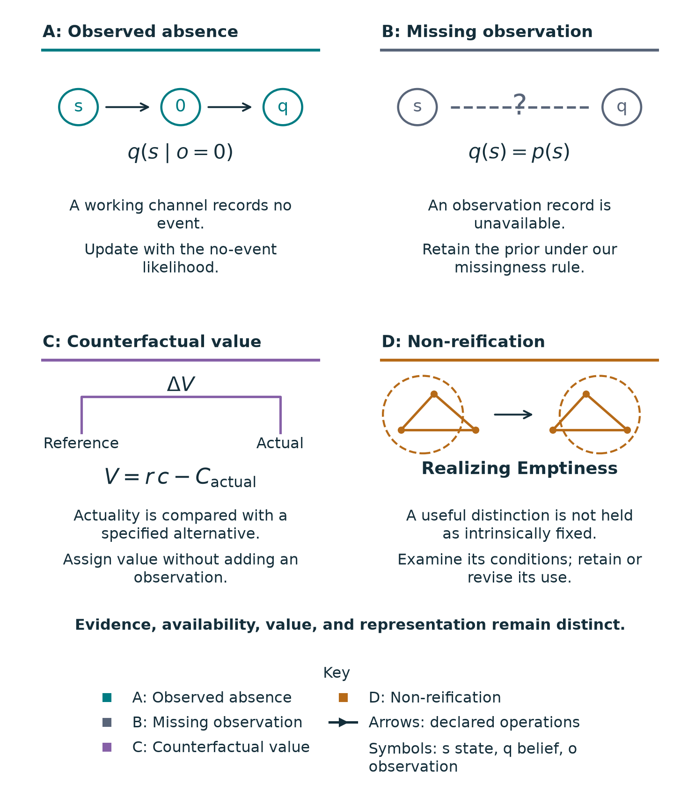

# Thanks for Nothing

A research package and manuscript about gratitude, absence, model
revisability and the practice of realizing emptiness. It reconstructs the supplied
gratitude and attention notebooks, implements corrected paired experiments, and
tests an explicitly new appreciation–inquiry proposal.

Original code is [MIT](LICENSE); the paper and original figures are
[CC BY 4.0](LICENSE-PAPER.md). Third-party rights remain separate.
The manuscript and single-commit code snapshot are archived together at
[doi:10.5281/zenodo.23402517](https://doi.org/10.5281/zenodo.23402517). Code release:
[v0.11.0](https://github.com/docxology/thanks_for_nothing/releases/tag/v0.11.0).
The archive description reproduces the paper abstract. See the
[release guide](docs/publication-handoff.md) for contents, citation and verification.

The finite models distinguish observed absence, missing observation,
counterfactual value and non-reification. They separate valuing inquiry, choosing
activity, gaining actual access, retaining or revising a working representation,
and evaluating consequences independently. Synthetic model behavior is not a
measure of human gratitude, eye tracking, clinical benefit or realization.

## Read the project

- [Documentation index](docs/README.md)
- [Question-by-question manuscript reading guide](docs/manuscript-reading-guide.md)
- [Manuscript](output/manuscript.pdf) and [standalone HTML](output/manuscript.html)
- [Generated current facts and settings](output/reports/research_summary.md)
- [Publication build and source bindings](output/reports/publication_build.json)
- [Model authority](docs/model-contract.md) and [architecture](docs/architecture.md)
- [Values and numerical provenance](docs/manuscript-values.md)
- [Visualizations and captions](docs/visualizations.md)
- [Ancient texts and wisdom traditions](docs/wisdom-traditions.md)
- [Evidence ceilings](docs/evidence-ceilings.md)

The main Results explain the cognitive situation alongside selected readouts.
The cover is followed by conceptual and experimental graphical abstracts, a
dedicated GNN Bayesian model-card page, then the contents. Each abstract separates the implemented operation, its finding and
the evidence limit; links lead to the detailed sections. These front-matter
images are separate from numbered scientific figures.
The model card derives dimensions and execution roles from admitted declarations;
its complete HTML/JSON companion preserves all settings, tensors and provenance.
Complete executable GNN instances are retained before their tensors enter the
numerical consumers; the [model contract](docs/model-contract.md#complete-standalone-generative-laws)
details process, readout, query and support coverage.
Detailed comparisons, bar plots, complete interval tables, formal derivations and
the prospective empirical design remain in the technical supplement. Scientific
figures share semantic colors, visible keys and source-bound PNG/SVG export.

## Build and qualify

Use the [canonical manuscript guide](docs/manuscript/README.md) to render the
sealed paper, supplement, and figures with the pinned Template without new
simulations or source acquisition. The separate [reproduction guide](docs/reproducibility.md)
describes the locked runtime, finite offline checks, and prerequisites for an
authorized full source reconstruction.

## Inputs and outputs

Licensed original preprints remain under [data/sources](data/sources).
Original notebooks require separate [local acquisition](docs/external-inputs.md);
they are excluded from this public snapshot because no redistribution license was verified.
[Source pins](src/thanks_for_nothing/provenance.py) independently check their
identities. [Scholarship](data/scholarship/sources.json) records access scope and
evidence ceilings; the [bibliography](docs/manuscript/references.bib) identifies
the inspected editions.

[Packaged GNN models](src/thanks_for_nothing/models) own the numerical model
choices. The [source map](output/reports/figure_source_map.json),
[variable ledger](output/reports/manuscript_variables.json),
documentation and validation reports in [the reports directory](output/reports)
expose the bindings.
[THIRD_PARTY.md](THIRD_PARTY.md) records external artwork and source attribution.

This repository contains one public snapshot commit; private development history
is preserved separately. The pipeline performs no deposition or publication.
See [production](docs/manuscript-production.md),
[CITATION.cff](CITATION.cff) and the [changelog](CHANGELOG.md).
The [release guide](docs/publication-handoff.md) records reciprocal archive links,
preprint license decisions, notebook exclusions and qualification boundaries.
